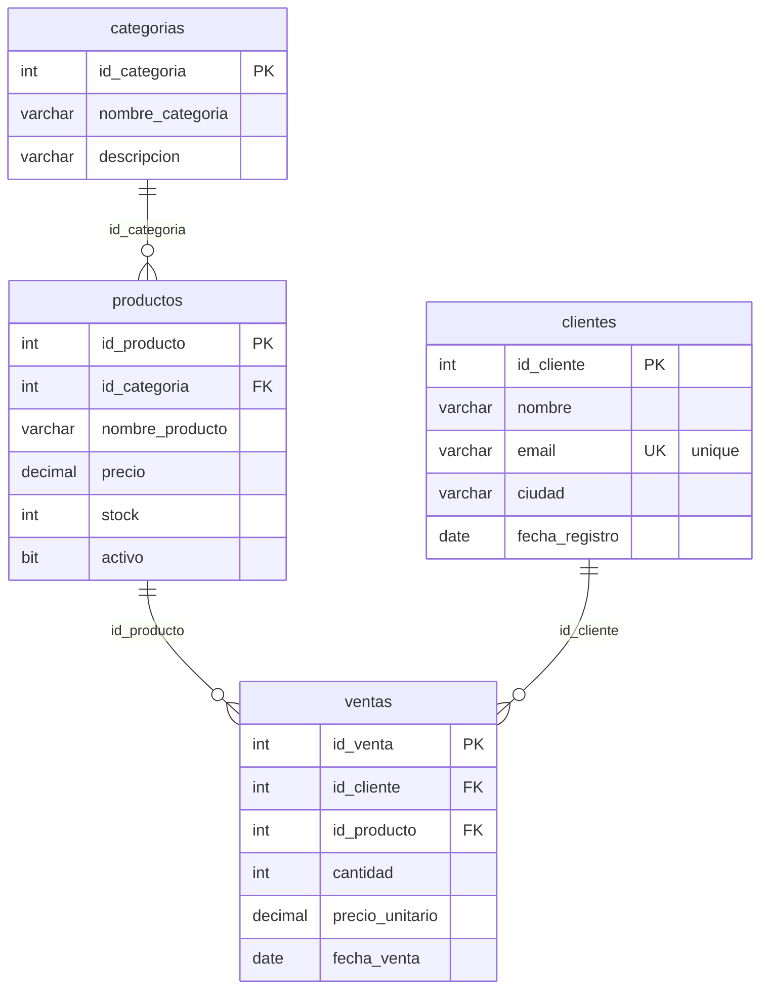

# RetailPro — Módulo 04: Consultas SQL para Análisis Comercial

Repositorio del proyecto **RetailPro**: modelado de una base de datos de ventas transaccionales y desarrollo de consultas analíticas en **SQL (MySQL 8.0)** para responder preguntas clave del negocio comercial.

---

## 📌 1. Descripción general del proyecto

**RetailPro** es un análisis de datos orientado al área **comercial** de un comercio de tecnología (electronics retail). A partir de las transacciones de ventas registradas en la base de datos `Ventas_Tech_DB`, el proyecto busca responder preguntas de negocio como:

- ¿Cuánto se facturó por mes y cuál es el ticket promedio?
- ¿Qué productos generan más ingresos y cuáles mueven más volumen?
- ¿Qué clientes son recurrentes y cuánto gastan?
- ¿Qué meses performan por encima o por debajo del promedio?

### 🎯 Objetivo comercial

Convertir datos transaccionales crudos en **hallazgos accionables** para el equipo comercial:

| Hallazgo | Implicancia comercial |
|---|---|
| **Concentración de producto** | Más de la mitad de la facturación proviene de un solo producto estrella (*Laptop Pro 15*). El negocio depende fuertemente de ese SKU. |
| **Retención de clientes** | Todos los clientes activos volvieron a comprar al menos una vez: buena señal de retención y recompra. |
| **Volumen ≠ Rentabilidad** | Los productos que más se venden en monto o en cantidad **no son necesariamente los que más margen dejan**. Hay que analizar rentabilidad antes de definir qué productos empujar. |

---

## 🛠️ 2. Tecnologías y herramientas utilizadas

- **MySQL 8.0 (Oracle)** — motor de base de datos relacional y lenguaje de consultas.
- **SQL** — DDL (creación de tablas), DML (cargas de datos) y consultas analíticas (`GROUP BY`, `HAVING`, subconsultas, `CASE WHEN`, funciones de agregación).
- **Power BI** — modelado semántico y construcción del dashboard comercial.
- **DAX** — medidas y cálculos avanzados (ticket promedio, % de participación, variaciones).
- **Power Query / ETL** — extracción, transformación y carga de datos hacia el modelo analítico.
- **Excel** — validación de cifras y análisis complementario.

---

## 🗄️ 3. Estructura de la base de datos `Ventas_Tech_DB`

La base sigue un **modelo estrella**: una tabla de hechos (`ventas`) conectada a tres tablas de dimensión (`categorias`, `productos`, `clientes`) mediante claves foráneas.



### Tablas de dimensión (descriptivas)

| Tabla | Clave primaria (PK) | Descripción |
|---|---|---|
| `categorias` | `id_categoria` (AUTO_INCREMENT) | Agrupa los productos: Computación, Accesorios, Audio, Almacenamiento. |
| `productos` | `id_producto` | Catálogo de productos con precio, stock y estado (activo/inactivo). |
| `clientes` | `id_cliente` | Clientes con email único, ciudad y fecha de registro. |

### Tabla de hechos (transaccional)

| Tabla | Clave primaria (PK) | Claves foráneas (FK) | Descripción |
|---|---|---|---|
| `ventas` | `id_venta` | `id_cliente` → `clientes.id_cliente`<br>`id_producto` → `productos.id_producto` | Una fila por línea de venta: cantidad, precio unitario y fecha. Contiene solo IDs (para conectar con las dimensiones) y campos numéricos/de fecha. |

---

## 🚀 4. Instrucciones de ejecución paso a paso

> ⚠️ **Importante:** el orden de creación y de borrado respeta las *Foreign Keys*. Siempre se crean primero las tablas **referenciadas** (dimensiones) y después las que **referencian** (hechos). Para borrar, el orden es inverso.

### Paso 1 — Crear la base de datos

```sql
CREATE DATABASE Ventas_Tech_DB;
USE Ventas_Tech_DB;
```

### Paso 2 — Dropear tablas existentes (orden inverso a la creación)

Se eliminan primero las tablas hijas para no violar las FKs:

```sql
DROP TABLE IF EXISTS ventas;     -- hechos (referencia a productos y clientes)
DROP TABLE IF EXISTS productos;  -- referencia a categorias
DROP TABLE IF EXISTS clientes;
DROP TABLE IF EXISTS categorias; -- dimensión padre, se borra al final
```

### Paso 3 — Crear las tablas dimensionales (primero las referenciadas)

```sql
-- 3.1 Dimensión categorías (no referencia a nadie)
CREATE TABLE categorias (
    id_categoria INT PRIMARY KEY AUTO_INCREMENT,
    nombre_categoria VARCHAR(50) NOT NULL,
    descripcion VARCHAR(200)
);

-- 3.2 Dimensión productos (FK -> categorias)
CREATE TABLE productos (
    id_producto INT PRIMARY KEY,
    id_categoria INT NOT NULL,
    nombre_producto VARCHAR(50),
    precio DECIMAL(10,2) NOT NULL,
    stock INT DEFAULT 0,
    activo BIT DEFAULT 0,
    FOREIGN KEY (id_categoria) REFERENCES categorias(id_categoria)
);

-- 3.3 Dimensión clientes (sin FKs)
CREATE TABLE clientes (
    id_cliente INT PRIMARY KEY,
    nombre VARCHAR(50) NOT NULL,
    email VARCHAR(100) UNIQUE,
    ciudad VARCHAR(50),
    fecha_registro DATE NOT NULL
);
```

### Paso 4 — Crear la tabla de hechos `ventas` (al final, porque referencia a `clientes` y `productos`)

```sql
CREATE TABLE ventas (
    id_venta INT PRIMARY KEY,
    id_cliente INT NOT NULL,
    id_producto INT NOT NULL,
    cantidad INT NOT NULL,
    precio_unitario DECIMAL(10,2) NOT NULL,
    fecha_venta DATE NOT NULL,
    FOREIGN KEY (id_cliente) REFERENCES clientes(id_cliente),
    FOREIGN KEY (id_producto) REFERENCES productos(id_producto)
);
```

### Paso 5 — Cargar los datos (INSERT)

Respetando las FKs, se cargan en este orden:

1. `categorias` (4 registros: Computación, Accesorios, Audio, Almacenamiento)
2. `productos` (6 registros: Laptop Pro 15, Mouse Inalámbrico, Monitor 4K 27, Auriculares BT Pro, SSD Externo 1TB, Teclado Mecánico)
3. `clientes` (5 registros)
4. `ventas` (10 registros correspondientes a marzo 2024)

> 💡 Verificación sugerida tras cada carga: `SELECT * FROM <tabla>;`

---

## 📊 5. Consultas analíticas del negocio

El script incluye 4 consultas que responden a las preguntas clave del área comercial.

### Consulta 1 — Resumen ejecutivo mensual

Total facturado, cantidad de pedidos y **ticket promedio** agrupados por mes.

```sql
SELECT
    MONTH(fecha_venta) AS mes,
    SUM(cantidad * precio_unitario) AS total_facturado,
    COUNT(DISTINCT id_venta) AS cantidad_pedidos,
    SUM(cantidad * precio_unitario) * 1.0 / COUNT(DISTINCT id_venta) AS ticket_promedio
FROM ventas
GROUP BY MONTH(fecha_venta)
ORDER BY mes ASC;
```

- Calcula el total como `cantidad * precio_unitario`.
- Usa alias descriptivos en español y `MONTH(fecha_venta)` para agrupar (en PostgreSQL sería `EXTRACT(MONTH FROM fecha_venta)`).

### Consulta 2 — Ranking de productos (Top 5)

Top 5 de productos por **total facturado**, incluyendo unidades vendidas.

```sql
SELECT
    id_producto,
    SUM(cantidad * precio_unitario) AS total_vendido,
    SUM(cantidad) AS total_unidades_vendidas
FROM ventas
GROUP BY id_producto
ORDER BY total_vendido DESC
LIMIT 5;
```

- En MySQL se usa `LIMIT 5` (equivalente a `TOP 5` en SQL Server).
- Permite detectar el producto estrella y comparar **monto vs. volumen** (ej.: el Mouse es el más vendido en unidades pero aporta poco al total facturado).

### Consulta 3 — Clientes recurrentes

Clientes con **más de un pedido**, con cantidad de pedidos y total gastado.

```sql
SELECT
    id_cliente,
    COUNT(DISTINCT id_venta) AS cantidad_pedidos,
    SUM(cantidad * precio_unitario) AS total_gastado
FROM ventas
GROUP BY id_cliente
HAVING COUNT(DISTINCT id_venta) > 1
ORDER BY total_gastado DESC;
```

- Usa `GROUP BY` + `HAVING` para filtrar solo clientes que recompraron (medidor de **retención**).

### Consulta 4 — Meses por encima / por debajo del promedio

Etiqueta cada mes con `CASE WHEN` según supere o no el promedio mensual general.

```sql
SELECT
    MONTH(fecha_venta) AS mes,
    SUM(cantidad * precio_unitario) AS total_facturado,
    CASE
        WHEN SUM(cantidad * precio_unitario) > (
            SELECT AVG(total_mes)
            FROM (
                SELECT SUM(cantidad * precio_unitario) AS total_mes
                FROM ventas
                GROUP BY MONTH(fecha_venta)
            ) AS sub
        )
        THEN 'Por encima' ELSE 'Por debajo'
    END AS estado
FROM ventas
GROUP BY MONTH(fecha_venta)
ORDER BY mes;
```

- Combina agregación, **subconsulta** y lógica condicional para construir un semáforo de performance mensual.

---

## 🧭 Roadmap / extensiones posibles

- Cruces adicionales por **categoría** y por **ciudad de cliente** (`JOIN` entre hechos y dimensiones).
- Incorporar **margen/costo** para analizar rentabilidad real por producto.
- Conectar la base a **Power BI** para el dashboard comercial con medidas en **DAX**.
